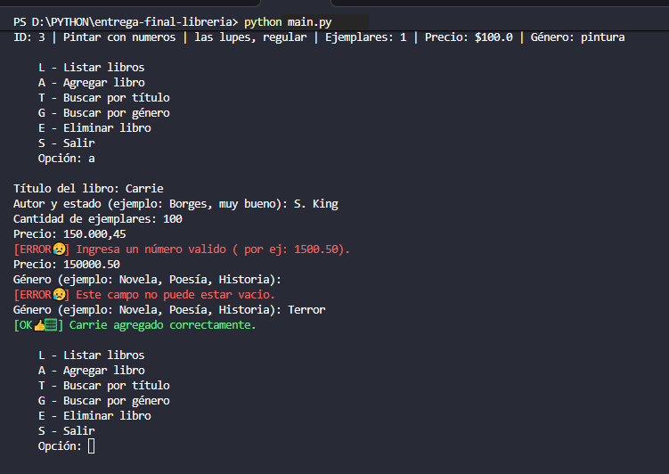

# Gestor de librería de libros usados 



El programa  gestiona una librería de libros usados desde la terminal. Permite cargar, eliminar, buscar (por título o por género) y listar libros. Los datos se guardan en una base de datos, así que siguen ahí aunque cierre el programa.

Todavía no controla el stock. Cada libro guarda su cantidad de ejemplares, pero por ahora solo se muestra. Más adelante quiero que avise cuando a un libro le quede un solo ejemplar.

## Cómo ejecutarlo
```bash
python -m pip install colorama
python main.py
```

*La base de datos libreria.db se crea sola la primera vez.

### Menú
**L**	Lista todos los libros  -
**A**	Agrega un libro -
**T**	Busca por título -
**G**	Busca por género -
**E**	Elimina un libro por ID -
**S**	Sale del programa


### Dividi el programa en 4 archivos para que quede mas ordenado. Cada uno hace una sola cosa.

**colores.py:** define los colores de colorama para los mensajes. Verde para éxito y rojo para error.
entradas.py: controla que lo que escribe el usuario sea correcto. Si escribe texto donde va un número, atrapa el ValueError con try-except, avisa en rojo y vuelve a preguntar. Lo mismo si deja un campo vacío o pone un número negativo.

**base_datos.py:** se encarga de todo lo que tiene que ver con la base libreria.db, usando sqlite3:
execute() ejecuta las órdenes SQL, como crear la tabla o insertar un libro.
cursor es lo que permite leer y escribir en la base.
commit() guarda los cambios.
close() cierra la conexión.
Si algo sale mal, rollback() deshace lo que se estaba haciendo para no dejar datos a medias.

**main.py:** es el archivo que se ejecuta. Importa a los otros tres y muestra el menú. Tiene las funciones de listar, agregar, buscar y eliminar, y las conecta con la base de datos.

### Cómo funciona una opción : A, agregar libro 
1. En el menú elijo A.
main.py empieza a pedir los datos uno por uno: título, autor y estado, ejemplares, precio y género.
2. Cada dato pasa por entradas.py, que vigila que esté bien escrito. Si hay un error, lo avisa y vuelve a preguntar.
3. Con todos los datos listos, main.py se los pasa a base_datos.py, que los guarda en la base.
4. Al terminar se muestra un mensaje: verde si se guardó bien, rojo si hubo un error. Los colores salen de colores.py.

### Cómo funciona una opción : E, Eliminar un libro
Antes de borrar, el programa verifica que el ID exista, muestra el libro y pide confirmación (S/N). Si no confirmo, no se borra nada.

Próximamente
-Avisar cuando a un libro le quede un solo ejemplar.
-Actualizar los datos de un libro.
